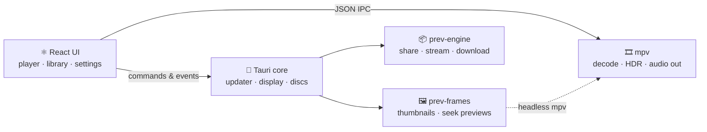
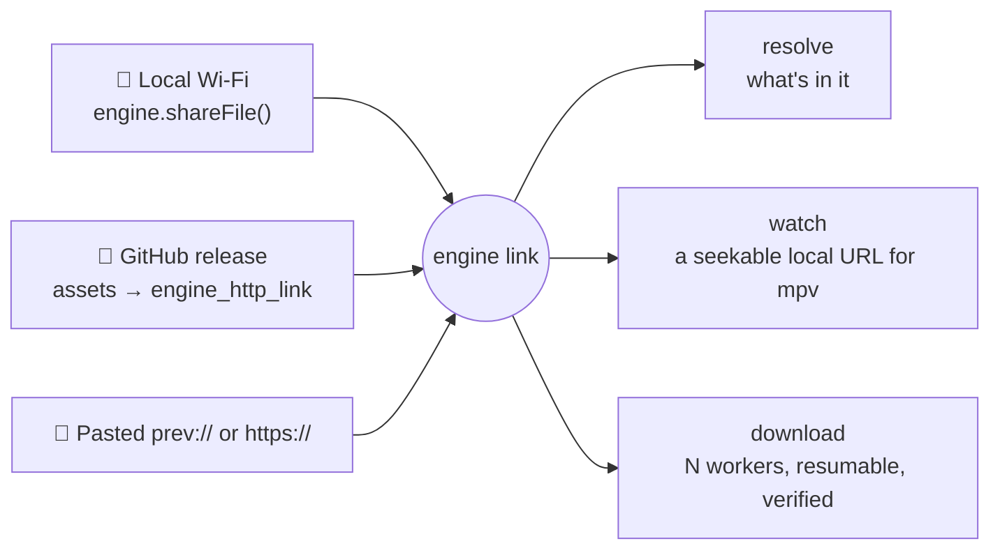
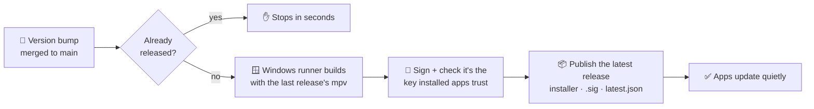

<div align="center">


# PREV Player

### Every format. Every frame. Every second.

A video player for Windows with mpv's engine underneath and a calm, modern face on top.<br/>
Previews for every second of the seek bar, HDR and Dolby that just work, and sharing built in.

<br/>

<a href="https://github.com/Arouzefst1/Prev-Player/releases/latest"></a>

<sub>Free and open source&nbsp; · &nbsp;Windows 10 & 11, 64-bit&nbsp; · &nbsp;No admin rights needed&nbsp; · &nbsp;Updates itself quietly</sub>

<br/><br/>

[](https://github.com/Arouzefst1/Prev-Player/releases/latest)
[](https://github.com/Arouzefst1/Prev-Player/releases)
[](LICENSE)
[](https://tauri.app)
[](engine)
[](components)
[](https://mpv.io)

**[Download](#-download)** &nbsp;·&nbsp; **[Features](#-features)** &nbsp;·&nbsp; **[Shortcuts](#-keyboard-shortcuts)** &nbsp;·&nbsp; **[Under the hood](#-under-the-hood)** &nbsp;·&nbsp; **[Build it](#-build-from-source)**

</div>

<br/>

<table>
<tr>
<td width="33%" valign="top">

### 🎯 See before you seek

Hover anywhere on the seek bar and see **that exact second**, with the chapter it falls in. Drag, and the knob, the picture and a thin guide stay right under your pointer.

</td>
<td width="33%" valign="top">

### 🌈 HDR that just works

**HDR10, HDR10+, HLG and Dolby Vision**, tone-mapped by mpv. If you want, it flips Windows into HDR for HDR films and matches your screen to the film's frame rate.

</td>
<td width="33%" valign="top">

### 📡 Share in one click

Send a video or a whole folder to anyone on your Wi-Fi, or through GitHub. They can **start watching before it has downloaded**, and keep it if they like.

</td>
</tr>
</table>

<br/>

## ✨ Features

<table>
<tr>
<td width="50%" valign="top">

#### 🎬 Plays everything

- Every format mpv plays: MKV, MP4, HEVC, AV1, VP9, VVC, ProRes…
- Audio from MP3 and AAC to FLAC, TrueHD, DTS-HD and DSD
- Hardware decoding and frame-exact seeking
- New files start instantly, even while another one is playing

</td>
<td width="50%" valign="top">

#### 🔁 Picks up where you left off

- Every video resumes at the second you stopped
- Playlists resume at the video you were on
- A queue with loop-one and loop-all, saved to your library as a bookmark
- Playback speed panel, and <kbd>Space</kbd> held down for 2×

</td>
</tr>
<tr>
<td width="50%" valign="top">

#### 📚 A library that looks after itself

- Thumbnails and lengths for everything, MKV, HEVC, HDR and Dolby files included
- Folders you arrange by dragging, in a grid or a list
- Music tiles for audio files
- Drop files on the window, or open them straight from Explorer

</td>
<td width="50%" valign="top">

#### 🪟 A real mini player

- Floats above your other windows while you work
- Snaps to corners and keeps the video's shape as you resize it
- Remembers where you put it and how big it was
- Portrait clips get a taller frame, so shorts aren't tiny

</td>
</tr>
<tr>
<td width="50%" valign="top">

#### 🏠 Home-theater ready <sup>opt-in</sup>

- Switch Windows to HDR for HDR videos, and back afterwards
- Match the display's refresh rate to the film: no more 24p judder
- Bitstream **Dolby Atmos** and **DTS:X** to an AV receiver
- Blu-ray and DVD ISOs and disc folders, with a title picker

</td>
<td width="50%" valign="top">

#### 💬 Audio & subtitles your way <sup>opt-in</sup>

- Picks the best audio track for you, and remembers your choices
- Forced subtitles shown automatically
- A second subtitle line, for language learning
- Subtitles pop up when you skip back to re-hear a line

</td>
</tr>
<tr>
<td width="50%" valign="top">

#### 🎛 Made to be tinkered with

- Rebind the player's keys in Settings
- A right-click menu: Loop, Stats for nerds, Mini player, Fullscreen, Properties
- **Stats for nerds** (<kbd>I</kbd>): live codec, HDR, decoder, bitrate, buffer and A/V sync
- Sound keeps playing when you switch headphones or speakers

</td>
<td width="50%" valign="top">

#### ⚡ Share, stream & download

- **Local Wi-Fi:** one link that works across every network adapter, plus a one-click firewall fix
- **GitHub:** share through a release, with nothing to host
- **Watch online** without saving, from a bounded memory buffer, or **save while you watch**
- Downloads use parallel connections, resume after a restart, and are checked against the source's checksum when it publishes one

</td>
</tr>
</table>

> [!TIP]
> Everything marked **opt-in** is off until you switch it on in **Settings**, so nothing changes behind your back.

## 🎹 Keyboard shortcuts

| Key | Action | | Key | Action |
|:---:|:---|---|:---:|:---|
| <kbd>Space</kbd> | Play / pause · hold for 2× | | <kbd>F</kbd> | Fullscreen |
| <kbd>K</kbd> | Play / pause | | <kbd>P</kbd> | Mini player |
| <kbd>←</kbd> <kbd>→</kbd> | Back / forward 5 seconds | | <kbd>Q</kbd> | Queue |
| <kbd>J</kbd> | Back 10 seconds | | <kbd>N</kbd> <kbd>B</kbd> | Next / previous video |
| <kbd>↑</kbd> <kbd>↓</kbd> | Volume | | <kbd>L</kbd> | Loop |
| <kbd>M</kbd> | Mute | | <kbd>C</kbd> | Subtitles on / off |
| <kbd>&lt;</kbd> <kbd>&gt;</kbd> | Slower / faster | | <kbd>I</kbd> | Stats for nerds |
| <kbd>0</kbd> … <kbd>9</kbd> | Jump to 0 % … 90 % | | <kbd>Esc</kbd> | Leave fullscreen / mini player |

🖱 **Scroll** for volume &nbsp;·&nbsp; **double-click** for fullscreen &nbsp;·&nbsp; **right-click** for the menu. Every key except <kbd>Space</kbd>, <kbd>0</kbd>–<kbd>9</kbd> and <kbd>Esc</kbd> can be changed in **Settings › Keyboard shortcuts**.

## 📥 Download

1. Download **`PREV.Player_<version>_x64-setup.exe`** from the [latest release](https://github.com/Arouzefst1/Prev-Player/releases/latest).
2. Run it. It installs just for you, with no admin prompt, and sets up Microsoft WebView2 if Windows doesn't already have it.
3. Play something: drop files on the window, click **Open Videos**, or choose **Open with › PREV Player** on any video or audio file.

> [!NOTE]
> **You only install it once.** New versions download in the background and install when you close the app. No pop-ups and nothing to click; the next launch is simply the newest version.

<br/>

---

<div align="center">

### 🛠 For developers

<sub>How it's built, how to build it, and how a release ships.</sub>

</div>

## 🧠 Under the hood

PREV Player is a [Tauri 2](https://tauri.app) app. The React UI drives **mpv** over its JSON IPC for everything you see and hear. Everything else lives in a Rust workspace: a frame engine for thumbnails and previews, and a chunked transfer engine for every byte that moves between devices.



```
prev-player/
├─ App.tsx, components/   the player: library, controls, settings, mini player
├─ mpv.ts                 mpv over JSON IPC: loading, seeking, tracks, events
├─ frames.ts              thumbnails and seek previews from the frame engine
├─ engine.ts              the transfer engine's bridge: every engine_* command, one event feed
├─ share.ts               GitHub accounts and uploads, and link ⇄ engine link
├─ engine/crates/         prev-core · transport · share · download · stream · engine · frames
├─ src-tauri/src/         the app shell: commands, updater, display (HDR/refresh), discs, sharing
├─ scripts/               release.mjs · release-notes.mjs · latest-json.mjs
└─ .github/workflows/     release.yml: builds, signs and publishes
```

### How a share flows

Everything reduces to **one engine link**, and after that there is only one path:



- **Local Wi-Fi:** `engine.shareFile()` mints the link, and `share.ts` wraps it in a `prevplayer://` URL so the OS hands clicks back to the app.
  - The link carries **every** LAN address the sender has, since a VPN, WSL or Hyper-V adapter, or a second network card, can each own the "obvious" one.
  - The receiver asks all of them at once and uses whichever serves the share.
  - When none answers, the usual cause is Windows Firewall on the sender: Windows marks home Wi-Fi as *Public* and blocks incoming connections there. The **Allow through firewall** button in the Share window fixes it with one UAC prompt.
- **GitHub:** `share.ts` uploads the assets and looks the release up, which needs a token and the REST API. `engine_http_link` then turns the asset list into an engine link. The wire format stays in Rust.
- **Pasted `prev://` or bare `https://`:** passes straight through.

A folder share you watch online opens one stream at a time. The session for an item is created when you reach it and freed when you leave, because opening every item up front would mean one prefetching buffer per file.

Under *Downloads & updates* there are two engine settings:
- **Streaming buffer:** 50 MB to 1 GB, default 256 MB.
- **Download connections:** set from the CPU count by default.

Both live in Rust, in `%APPDATA%/com.prev-player.app/engine.json`, because they're read before the first window exists and a live stream can't be resized. Changes apply on the next launch, which the panel says.

<details>
<summary><b>History: how the chunk engine replaced the old downloader</b></summary>

<br/>

| Before | Now |
|---|---|
| `share.rs::download_file`: one stream, append-only, resumes by file length | `Engine::download`: N workers, chunk map, verified, resumes by chunk |
| `share.rs::download_control` | `Engine::pause` / `resume` / `cancel` |
| `lan.rs`: whole file, ids from nanotime, **no `Content-Length` over 32 KB, so receivers couldn't seek** | `Engine::share_file` / `share_folder`: hash-derived ids, lazy digests, ranges that work |
| *(nothing)* | `Engine::watch`: watch online against a bounded RAM buffer |
| *(nothing)* | `Engine::save_stream`: keep what you're watching, straight out of the buffer |
| downloads vanished on quit | the chunk map is on disk; they come back resumable |

`lan.rs` is gone entirely. `share.rs` kept only the GitHub REST passthrough and the streaming asset upload. A release asset URL is a range-serving HTTP source like any other, so the engine downloads and streams it directly.

</details>

## 🔧 Build from source

You need [Node.js](https://nodejs.org) 20+ and [Rust](https://rustup.rs) (stable). The installer is built on Windows.

```bash
npm install
npm run dev      # vite + tauri, with hot reload
npm run build    # installer → src-tauri/target/release/bundle/nsis/
```

> [!IMPORTANT]
> **mpv is not in this repo.** The app bundles `mpv.exe` (~115 MB) plus `d3dcompiler_43.dll` at `src-tauri/resources/mpv/`. They're declared in `bundle.resources` and resolved at runtime via `resolveResource`. That directory is git-ignored because of its size, so drop a Windows mpv build there before packaging. In development the app falls back to whatever `mpv` is on `PATH`, so `npm run dev` works without it.

Test the engine on its own:

```bash
cd engine && cargo test --workspace     # 130+ tests
```

## 🚀 Releasing

**Releases ship themselves.** Bump the version in **three** files (`package.json`, `src-tauri/tauri.conf.json` and `src-tauri/Cargo.toml`) and add a section for it at the top of [RELEASE_NOTES.md](RELEASE_NOTES.md):

```md
## 1.6.2 — one line on what changed

What's new, for the release page.
```

Merge it to `main`, and about ten minutes later every installed copy can update:



The **Release** workflow (`.github/workflows/release.yml`) refuses to publish with any key other than the one installed apps trust. Every pull request gets a **test build** instead: the same build, with nothing published and the installer attached to the run to try out. You can also run the workflow by hand from the Actions tab, to retry a release or to announce one. It needs one repository secret, set once: **`TAURI_SIGNING_PRIVATE_KEY`**, the text of `src-tauri/prev-player-updater.key`.

<details>
<summary><b>Releasing by hand</b></summary>

<br/>

With the signing key at `src-tauri/prev-player-updater.key` (git-ignored, never committed), run one of these:

```bash
npm run release                                  # notes from RELEASE_NOTES.md
npm run release -- "What changed, in one line"
```

It does the same build, signing and checks, writes `latest.json` marked `"silent": true`, and prints a link to a pre-filled GitHub release form. Publish the installer, its `.sig` and `latest.json` on a release tagged `v<version>`. Mark it **latest**, not a draft or pre-release, because the updater only reads `releases/latest`.

It never asks for a password. The key's password is empty, and PowerShell can't hold an empty environment variable, so the build runs without the key and the installer is signed right after. A key kept elsewhere can be given as `TAURI_SIGNING_PRIVATE_KEY` (its text or path), with `TAURI_SIGNING_PRIVATE_KEY_PASSWORD` if it has a password.

</details>

<details>
<summary><b>Silent or announced updates</b></summary>

<br/>

A silent release reaches every install on 1.5.2 or newer without anyone doing anything. It downloads in the background, installs when the user closes the app, and the next launch is the new version.

To announce one instead, pass `--announce` or tick *Announce* when running the workflow by hand. That leaves the silent flag off:
- **Minor or major version:** the app shows a "ready, installs when you close the app" toast with a *Restart now* button.
- **Patch version:** stays quiet either way.

Installs older than 1.5.2 apply updates the way their own build does:
- **1.3.2 to 1.5.1:** installs and relaunches at launch.
- **1.3.1 and earlier:** shows a dialog.

The **private signing key is never committed.** `.gitignore` blocks every `*.key` and `*.key.pub`, so the key can sit in `src-tauri/` on the release PC. Only the signature and the public key (in `tauri.conf.json`) are ever published. The updater only moves forward and the identifier never changes (`com.prev-player.app`), so every release upgrades every existing install.

</details>

## 📜 Milestones

| Version | What it brought |
|:---:|---|
| [**1.6.1**](https://github.com/Arouzefst1/Prev-Player/releases/tag/v1.6.1) | Switching videos always works, files open instantly, audio thumbnails, a seek bar that keeps up |
| [**1.6.0**](https://github.com/Arouzefst1/Prev-Player/releases/tag/v1.6.0) | Seek previews, HDR support, stats for nerds, custom shortcuts, right-click menu |
| [**1.5.3**](https://github.com/Arouzefst1/Prev-Player/releases/tag/v1.5.3) | Resume a playlist where you left it |
| [**1.5.2**](https://github.com/Arouzefst1/Prev-Player/releases/tag/v1.5.2) | Audio survives device changes; silent updates |
| [**1.5.1**](https://github.com/Arouzefst1/Prev-Player/releases/tag/v1.5.1) | Works offline |
| [**1.5.0**](https://github.com/Arouzefst1/Prev-Player/releases/tag/v1.5.0) | The chunked transfer engine: parallel, resumable, verified downloads and watching online |
| [**1.3.0**](https://github.com/Arouzefst1/Prev-Player/releases/tag/v1.3.0) | A real picture-in-picture mini player, loop modes, queue bookmarks |
| [**1.2.0**](https://github.com/Arouzefst1/Prev-Player/releases/tag/v1.2.0) | Playback speed panel |
| [**1.1.0**](https://github.com/Arouzefst1/Prev-Player/releases/tag/v1.1.0) | The native engine |

<sub>Every release is on the [releases page](https://github.com/Arouzefst1/Prev-Player/releases).</sub>

## 📄 License

**[MIT](LICENSE)**: use it, modify it, sell it, redistribute it, fork it, rebrand it or sublicense it. Commercial use is included. No permission needed, no fees, no restrictions.

The one condition is that the copyright notice travels with the code:

```
Based on PREV Player — https://github.com/Arouzefst1/Prev-Player
Copyright (c) 2026 Arouzefst1 — MIT License
```

This covers **every release**, past and present. The engine crates under `engine/` are MIT too; the workspace has declared `license = "MIT"` since it was written.

No warranty: the software is provided **"as is"**, with no liability for damage or data loss.

> [!NOTE]
> **Redistributing the installer:** the bundled `mpv.exe` is GPL and isn't ours to relicense. The app talks to it over IPC as a separate process, so the copyleft stops at that binary and never reaches this code. Keep [LICENSE.md](LICENSE.md) alongside anything you ship that includes it. Or ship without it and let mpv come from `PATH`, in which case MIT is the only license involved.

📄 **[LICENSE.md](LICENSE.md)** has the license type, the warranty warning, and the full mpv and third-party notice in one place.

<br/>

<div align="center">


<sub><b>PREV Player</b>, made for people who care how their films look and sound.</sub>

<sub>[Back to top ↑](#prev-player)</sub>

</div>
